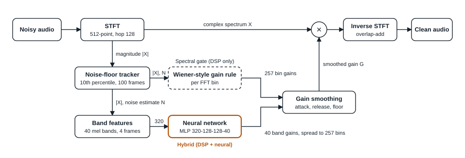

# Hybrid Dialogue Cleaner

A project by Atharva Bankar.

A dialogue noise-reduction prototype that combines classic DSP with a small neural network, benchmarked against a pure-DSP baseline.

**Status: stage 1 of 4, a Python proof of concept on synthetic audio.** The numbers below show the pipeline works; they are not yet evidence about real dialogue.

## How it works



Both cleaners share the STFT (512 / 128, sqrt-Hann), the noise-floor tracker (running low percentile), the gain smoothing and the overlap-add resynthesis. They differ only in what sets the gain: a fixed Wiener-style rule for the spectral gate (dashed box), or a small neural network for the hybrid (highlighted). The network's inputs are 40 mel band energies plus the DSP stage's own SNR estimate.

The network only predicts 40 band gains (the RNNoise idea), not a full spectrogram, and looks at past frames only. That keeps it small and causal, so it can later run in real time inside a plugin.

## Baseline

`dialogue_cleaner/baseline.py` is a spectral gate: the same noise-floor tracker, a Wiener-style gain with over-subtraction, and the same gain smoothing. It has not been carefully tuned, so the gap to the hybrid is probably flattering to the hybrid.

## First results (synthetic data)

SI-SDR in dB, higher is better. 8 clips per row, held-out random seeds.

| Noise | Input SNR | Noisy | Spectral gate | Hybrid |
|---|---|---|---|---|
| white | 0 | 0.0 | 2.1 | 11.7 |
| white | 10 | 10.0 | 12.5 | 19.4 |
| pink | 0 | 0.0 | 1.1 | 9.1 |
| pink | 10 | 10.0 | 11.3 | 18.3 |
| hum | 0 | 0.0 | 4.9 | 10.7 |
| hum | 10 | 10.0 | 13.3 | 15.2 |
| aircon | 0 | 0.0 | 1.0 | 5.1 |
| aircon | 10 | 10.0 | 11.2 | 13.9 |
| babble (unseen in training) | 0 | 0.0 | 0.2 | 2.0 |
| babble (unseen in training) | 10 | 10.0 | 10.2 | 11.5 |
| **Mean** | | **5.0** | **6.8** | **11.7** |

Caveats:

- The "speech" is synthesised (pulse source through formant filters), and the noises are synthesised too. Real dialogue and real room tone will be harder.
- The model trained on the same four noise generators it is tested on (different random seeds). Babble, the one unseen type, shows a much smaller gain.
- SI-SDR is not a perceptual score. PESQ, STOI and listening tests come in stage 2.

## Run it

```
pip install numpy scipy scikit-learn matplotlib
python run_demo.py
```

Trains in about a minute on CPU, prints the table, and writes four WAVs and `spectrograms.png` to `out/`.

## Web demo

`docs/index.html` is a single-file demo that runs the same algorithm in the browser (a JavaScript port in `web/dsp.js`, checked against the Python output to within 1e-7). It has three example clips, A/B switching between noisy, spectral gate, hybrid and clean, and lets you upload your own audio. With GitHub Pages enabled for the `docs/` folder it is served at https://atharvabankarsound.github.io/AI-Dialogue-Cleaner-DSP/.

The page also has a Reduce Noise button with an amount slider (0 to 100%), and a noise check that names the most likely kind of noise in an uploaded clip: white noise / hiss, broadband room tone, mains hum, low rumble, wind, background voices, telephone-quality audio, or little or no noise. The check is a small neural classifier on hand-built DSP features (`dialogue_cleaner/noise_id.py`). It scores 99.7% on held-out synthetic clips, which says little about real recordings: it has only ever seen synthetic noise, so treat its answer as a best guess.

Rebuild it after retraining:

```
python export_web.py      # trains the cleaner, writes web_model.json
python export_noise_id.py # trains the noise-type classifier, adds it to web_model.json
python web/build.py       # writes docs/index.html
```

## Roadmap

1. **Done:** DSP engine, baseline, hybrid proof of concept, evaluation harness.
2. **Real data:** train `train_torch.py` (GRU, not yet run) on real clean speech + real noise; add PESQ / STOI; tune the baseline properly; listening test.
3. **De-reverb:** extend the target from noise-only to noise + late reverberation.
4. **Plugin:** export to ONNX, real-time C++ port of the DSP in JUCE (VST3 / AU / AAX).

## Layout

| File | Purpose |
|---|---|
| `dialogue_cleaner/stft.py` | STFT / ISTFT from scratch |
| `dialogue_cleaner/bands.py` | mel band layout shared by both stages |
| `dialogue_cleaner/baseline.py` | spectral gate, noise-floor tracker, gain smoothing |
| `dialogue_cleaner/hybrid.py` | features, ideal-ratio-mask target, hybrid cleaner |
| `dialogue_cleaner/noise_id.py` | noise-type features and synthetic training clips |
| `dialogue_cleaner/metrics.py` | SI-SDR, log-spectral distance |
| `dialogue_cleaner/synth.py` | synthetic speech-like signal and noise generators |
| `run_demo.py` | train, evaluate, export examples |
| `train_torch.py` | PyTorch GRU trainer for real datasets (untested) |
| `export_web.py`, `web/`, `docs/` | browser demo: model export, JS port, built page |
